<p align="center">
  
</p>

# Telltale

**An isolated QNX 8.0 monitor that reads back the pixels an instrument cluster actually shows, checks them against the vehicle state, and puts the truth back on screen when the cluster lies.**

When a cluster freezes at 48 km/h and the car has stopped, nothing inside the renderer knows. Telltale is a separate process with its own security type: it reads the composed display from QNX Screen, decodes the digits and lamps, compares them with `/dev/vehicle`, and on a mismatch posts a safe layer with the true values, kills and respawns the renderer, verifies the new one, and hands the display back.

**QNX primitives on the critical path:** resource managers (`/dev/vehicle`, `/dev/telltale`, `/dev/telltale-events`), message passing (devctl, pulses, `ionotify` on the renderer's data path), SCHED_FIFO 60 for the monitor, QNX Screen (`screen_read_display`, `screen_post_window`), `secpol` (a type each for the feeder, vehicled, renderer and monitor), `slog2` (incident records). `slm` can supervise the renderer (exercised by the on-target `slm-freeze` test); the bench and recorded runs respawn it with a shell loop.

**Result, on QEMU (TCG), not hardware timing:** 200 injected faults in 4 classes, **0 missed**; detection p95 24.8 ms (BLANK) to 271.2 ms (STALE); 0 false positives in 91,029 checks of a 30-minute real drive; with the monitor off the glass is wrong for a median 29.9 s of a 30 s window. Not every target was met: see [DEMO.md](DEMO.md).

## How it works
<p align="center"></p>

1. `vehfeed` replays real CAN speed from the comma2k19 drive dataset (MIT) into `vehicled`, the `/dev/vehicle` resource manager.
2. `cluster` draws speed digits (a D-DIN glyph atlas), 6 lamps and a liveness tick with QNX Screen.
3. `telltale` runs every 20 ms (the configured `period_ms`, not a measured figure): `screen_read_display` of the composed digit, lamp and tick regions, decode, compare with the vehicle state.
4. On `VALUE_MISMATCH`, `TICK_STALL` or a blank: safe layer first, then a cause check through `/proc` (hung vs starved). The renderer is killed only if it is hung, drawing wrong or blank, or stalled for an unclassifiable cause for 5 x `tick_stall_ms`; a renderer classified as starved is not killed (0 of 50 STARVE runs restarted). Then a verified hand-back.

The monitor does no machine learning on purpose: the check is a deterministic glyph decode, so the same frame gives the same verdict.

## Target and toolchain
- **QNX Software Development Platform 8.0** (non-commercial license), `qcc` (GCC 12.2.0 backend), built through the SDP's Linux host tools in a `linux/amd64` Docker container on macOS ([`docker/`](docker/), [`scripts/qcc.sh`](scripts/qcc.sh)).
- **Target:** the QNX Everywhere Quick Start image, x86_64 guest under QEMU with TCG on an Apple-Silicon Mac (`scripts/run_qemu.sh`), Screen on the image's software virtual display. No Raspberry Pi or other hardware was used.
- Host tests need any POSIX `cc` and Python 3.11+.

## Build and run
```sh
# 1. toolchain image and binaries (needs QNX SDP 8.0 at ~/qnx800, or set QNX_SDP_HOST)
docker build --platform linux/amd64 -t telltale-qnx-host:local docker
make target                       # qcc -> out/x86_64/

# 2. boot the QNX guest (foreground; use a second terminal)
scripts/run_qemu.sh

# 3. start Screen, deploy, run one recorded fault
scripts/guest_screen.sh
scripts/deploy.sh
scripts/scenario.sh freeze        # -> evidence/runs/<id>-freeze/

# 4. tests
make test-host                    # C + Python, no QNX needed
make test-target                  # on-target suite, 163 passed / 0 failed at 985ab29
```
Reproduce every bench number: `scripts/bench_all.sh run` then `scripts/bench_all.sh report` (see [DEMO.md](DEMO.md)).

## Evidence
| What | Where |
|---|---|
| Bench tables, raw rows, reproduce steps | [DEMO.md](DEMO.md), [`evidence/RESULTS.md`](evidence/RESULTS.md), [`evidence/report.html`](evidence/report.html) |
| One recorded run per fault class | [`evidence/runs/`](evidence/runs/) |
| On-target test summary | [`evidence/test-target/20261115T232225Z/summary.txt`](evidence/test-target/20261115T232225Z/summary.txt) |
| Two failing test runs kept | [`20261115T141317Z`](evidence/test-target/20261115T141317Z/summary.txt), [`20261115T204528Z`](evidence/test-target/20261115T204528Z/summary.txt) |
| Every component, test and known limit | [`docs/ENGINEERING.md`](docs/ENGINEERING.md) |
| Developer-experience notes on the QNX toolchain | [`docs/DX-REPORT.md`](docs/DX-REPORT.md) |
| Input data provenance | [`data/SOURCES.md`](data/SOURCES.md) |

## Honest limits
- All timings are QEMU (TCG) on a loaded Mac, not hardware; QEMU ran without a visible display, so the glass is read back and captured to images by `ttshot`.
- The monitor is not supervised: nothing restarts `telltale` if it dies.
- Gear is drawn but not verified; speed digits, 6 lamps and the liveness tick are.
- Whole-CPU starvation (Screen, monitor, renderer and hog on one CPU) delays the safe layer until the hog ends; STARVE is reported as "renderer CPU only".
- The 200 injections are a declared population in one real 31-minute drive, not general coverage. Full list: [`docs/ENGINEERING.md`](docs/ENGINEERING.md#known-limits-measured).

## License
Apache-2.0, see [LICENSE](LICENSE).
