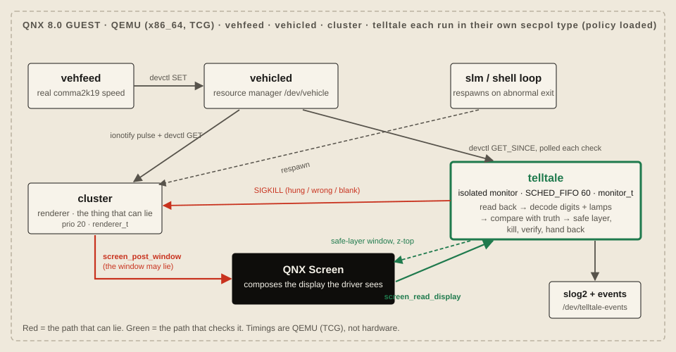

<div align="center">
  
  <h1>Telltale 🪞</h1>
  <p><em>An isolated QNX 8.0 monitor that reads back the pixels an instrument cluster actually shows, checks them against the vehicle state, and puts the truth back on screen when the cluster lies.</em></p>
  <picture>
    <source media="(prefers-reduced-motion: reduce)" srcset="docs/assets/readme-hero.png">
    
  </picture>

  <p><strong>QNX primitives on the critical path:</strong> resource managers (<code>/dev/vehicle</code>, <code>/dev/telltale</code>) · message passing (devctl, pulses, <code>ionotify</code>) · QNX Screen read-back (<code>screen_read_display</code>) · <code>SCHED_FIFO</code> 60 · <code>secpol</code> types · <code>slog2</code> incident records.</p>
  <p><strong>Result, on QEMU (TCG), not hardware timing:</strong> 200 injected faults in 4 classes, <strong>0 missed</strong> (bench built at <code>7592e40</code>; re-checked 25/25 at the current monitor <code>985ab29</code>); 0 false positives in 91,029 checks of a 30-minute real drive; median 29.9 s wrong glass with the monitor off.</p>

  <br/>

  [](https://telltale.edycu.dev)
  [](https://telltale.edycu.dev/codelab/)
  [](https://qnx.devpost.com/)

  <br/>

  
  
  
  [](LICENSE)
  [](https://github.com/edycutjong/telltale/actions/workflows/ci.yml)
  [](https://github.com/edycutjong/telltale/actions/workflows/codeql.yml)
  [](https://github.com/edycutjong/telltale/releases/latest)

</div>

---

## 💡 The Problem & Solution

### The Problem
When a cluster freezes at 48 km/h and the car has stopped, nothing inside the renderer knows.

### The Solution
Telltale is a separate process with its own security type: it reads the composed display from QNX Screen, decodes the digits and lamps, compares them with `/dev/vehicle`, and on a mismatch posts a safe layer with the true values, kills and respawns the renderer, verifies the new one, and hands the display back.

## 🏗️ Architecture & Tech Stack
<p align="center"></p>

1. `vehfeed` replays real CAN speed from the comma2k19 drive dataset (MIT) into `vehicled`, the `/dev/vehicle` resource manager.
2. `cluster` draws speed digits (a D-DIN glyph atlas), 6 lamps and a liveness tick with QNX Screen.
3. `telltale` runs every 20 ms (the configured `period_ms`, not a measured figure): `screen_read_display` of the composed digit, lamp and tick regions, decode, compare with the vehicle state.
4. On `VALUE_MISMATCH`, `TICK_STALL` or a blank: safe layer first, then a cause check through `/proc` (hung vs starved). The renderer is killed only if it is hung, drawing wrong or blank, or stalled for an unclassifiable cause for 5 x `tick_stall_ms`; a renderer classified as starved is not killed while its window is readable (0 of 50 STARVE runs restarted at `7592e40`, 0 of 5 at `985ab29`); with no readable window it is restarted once its no-window checks add up to `restart_timeout_ms` (4 s; reviewed, not exercised on the target). Then a verified hand-back.

The monitor does no machine learning on purpose: the check is a deterministic glyph decode, so the same frame gives the same verdict.

| Layer | Choice |
|---|---|
| OS / SDK | **QNX Software Development Platform 8.0** (non-commercial license), `qcc` (GCC 12.2.0 backend) |
| Build | SDP Linux host tools in a `linux/amd64` Docker container on macOS ([`docker/`](docker/), [`scripts/qcc.sh`](scripts/qcc.sh)) |
| Target | QNX Everywhere Quick Start image, x86_64 guest under QEMU with TCG on an Apple-Silicon Mac (`scripts/run_qemu.sh`), Screen on the image's software virtual display. No Raspberry Pi or other hardware was used |
| Languages | C (monitor, cluster, resource managers), Python 3.11+ (host tests, bench reports) |
| Host tests | any POSIX `cc`, Python 3.11+ and `pip install -r requirements-dev.txt` (ruff, Pillow, numpy; without Pillow and numpy, 10 of the 112 Python tests skip: 8 need Pillow, 2 need both) |

## 🏆 QNX Integration
- **Resource managers:** `/dev/vehicle`, `/dev/telltale`, `/dev/telltale-events`.
- **Message passing:** devctl, pulses, `ionotify` on the renderer's data path.
- **Scheduling:** SCHED_FIFO 60 for the monitor.
- **QNX Screen:** `screen_read_display` (read-back of the composed display), `screen_post_window` (the safe layer).
- **`secpol`:** a type each for the feeder, vehicled, renderer and monitor; enforced in the on-target test suite, not loaded during the timing bench.
- **`slog2`:** incident records.
- **`slm`** can supervise the renderer (exercised by the on-target `slm-freeze` test); the bench and recorded runs respawn it with a shell loop.

## 📊 Engineering Rigor
All timings are QEMU (TCG), not hardware. Not every target was met: see [DEMO.md](DEMO.md).

| Metric | Value |
|---|---|
| Injected faults | 200 in 4 classes, **0 missed** |
| Detection p95 | 24.8 ms (BLANK) to 271.2 ms (STALE) |
| False positives | 0 in 91,029 checks (first 30 minutes of a real 31-minute drive) |
| Wrong glass, monitor off | median 29.9 s of a 30 s window |
| On-target suite | 163 passed / 0 failed at `985ab29` |
| Built at | B1 faults `7592e40` · crash `5edab0a` · MISDRAW `f15744a` · ablation `d3d5892` · regression 25/25 and on-target suite `985ab29`, the current monitor (see [DEMO.md](DEMO.md#which-build-ran-each-bench)) |

**CI/CD Pipeline, 6 stages:** Quality (ruff; Python tests on 3.11-3.13 for pushes to main, 3.12 on pull requests), Security (gitleaks over the full history), Build (host C under gcc and clang; the QNX sources need the SDP, so CI cannot cross-build them), E2E replay (the cited on-target run: its summary matches this README, the code under test is unchanged since `985ab29`, and every recorded assertion is re-checked), Reproducibility (`evidence/RESULTS.md` and `report.html` regenerate byte-identical), Release (a semver tag only after every other stage passes). CodeQL runs in its own workflow over the Python and the host-buildable C (decode, truth, disp, text, rcap); the QNX-only sources are not in its database.

### Evidence
| What | Where |
|---|---|
| Bench tables, raw rows, reproduce steps | [DEMO.md](DEMO.md), [`evidence/RESULTS.md`](evidence/RESULTS.md), [`evidence/report.html`](evidence/report.html) |
| One recorded run per fault class | [`evidence/runs/`](evidence/runs/) |
| On-target test summary | [`evidence/test-target/20261115T232225Z/summary.txt`](evidence/test-target/20261115T232225Z/summary.txt) |
| Two failing test runs kept | [`20261115T141317Z`](evidence/test-target/20261115T141317Z/summary.txt), [`20261115T204528Z`](evidence/test-target/20261115T204528Z/summary.txt) |
| Every component, test and known limit | [`docs/ENGINEERING.md`](docs/ENGINEERING.md) |
| Developer-experience notes on the QNX toolchain | [`docs/DX-REPORT.md`](docs/DX-REPORT.md) |
| Input data provenance | [`data/SOURCES.md`](data/SOURCES.md) |

### Honest limits (6)
1. Not certified; Telltale makes no ISO 26262 or ASIL claim.
2. All timings are QEMU (TCG) on a loaded Mac, not hardware; QEMU ran without a visible display, so the glass is read back and captured to images by `ttshot`.
3. The monitor is not supervised: nothing restarts `telltale` if it dies.
4. Gear is drawn but not verified; speed digits, 6 lamps and the liveness tick are.
5. Whole-CPU starvation (Screen, monitor, renderer and hog on one CPU) delays the safe layer until the hog ends; STARVE is reported as "renderer CPU only".
6. The 200 injections are a declared population in one real 31-minute drive, not general coverage. Full list: [`docs/ENGINEERING.md`](docs/ENGINEERING.md#known-limits-measured).

## 🚀 Getting Started
Needs QNX SDP 8.0 at `~/qnx800` (or set `QNX_SDP_HOST`), Docker, and QEMU.

```sh
# 1. toolchain image and binaries
docker build --platform linux/amd64 -t telltale-qnx-host:local docker
make target                       # qcc -> out/x86_64/

# 2. boot the QNX guest (foreground; use a second terminal)
scripts/run_qemu.sh

# 3. start Screen, deploy, run one recorded fault
scripts/guest_screen.sh
scripts/deploy.sh
scripts/scenario.sh freeze        # -> evidence/runs/<id>-freeze/
```
Reproduce every bench number: `scripts/bench_all.sh run` then `scripts/bench_all.sh report` (see [DEMO.md](DEMO.md)).

## 🧪 Testing & CI
```sh
make test-host                    # C + Python, no QNX needed
scripts/replay_target_run.sh      # re-checks the committed on-target run, no QNX needed (CI Stage 4)
make test-target                  # on-target suite, 163 passed / 0 failed at 985ab29
```

## 📽️ Demo Materials
- Site: [telltale.edycu.dev](https://telltale.edycu.dev), the landing page, served from [`docs/`](docs/).
- [Pitch deck](https://telltale.edycu.dev/pitch/)
- [Codelab](https://telltale.edycu.dev/codelab/): your first QNX 8.0 resource manager on an Apple-Silicon Mac (every step run on the QEMU guest); sources in [`codelab/`](codelab/README.md).

## 📄 License
Apache-2.0, see [LICENSE](LICENSE).
